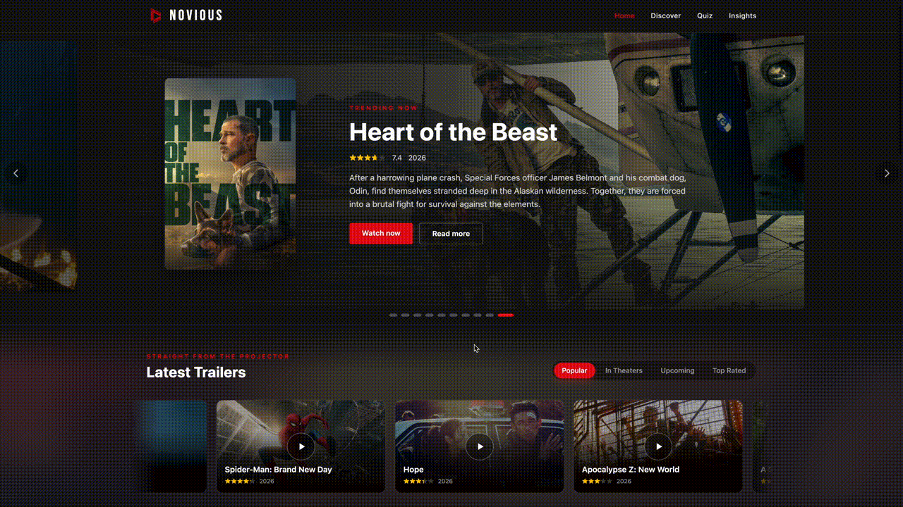

# NOVIOUS - MOVIE EXPLORER
### A Cinematic Movie Discovery Platform | React 19 - TMDB API

> A **single-page application** built to treat film data the way a magazine treats film: as something worth designing for.
> Five routes, 40 source files and roughly **5,600 lines** of React, CSS and vanilla JavaScript, with no component library, no UI kit, no chart template and **not a single audio file**.
> Every poster, rating, budget figure and sound in this project is either fetched live from TMDB or synthesised in the browser at runtime.

<p align="center">
  
  
  
  
  
</p>

---

<p align="center">
  
</p>

<p align="center"><i>Home carousel → Movie Machine → Frame by Frame → Cinema Decoded</i></p>

---

## Table of contents
1. [Project Overview](#1-project-overview)
2. [Technology Stack](#2-technology-stack)
3. [Source Code Architecture](#3-source-code-architecture)
4. [Service Layer Specifications](#4-service-layer-specifications)
5. [Feature Walkthrough](#5-feature-walkthrough)
6. [Frame by Frame — Game Engine](#6-frame-by-frame--game-engine)
7. [Data Visualization & Chart Analysis](#7-data-visualization--chart-analysis)
8. [Design System](#8-design-system)
9. [Execution Guide](#9-execution-guide)
10. [Technical Notes](#10-technical-notes)

---

## 1. Project Overview

| Information | Details |
|-------------|---------|
| **Objective** | Build a complete, production-shaped movie discovery SPA on a live public API |
| **Scope** | 5 routes · 23 components · 4 service modules · 4 static data tables |
| **Data source** | The Movie Database (TMDB) REST API v3 — live, never mocked |
| **HTTP layer** | Native `fetch` + `async`/`await` — **no `axios`, no wrapper library** |
| **State management** | React hooks only — no Redux, no Zustand, no Context provider tree |
| **Styling** | Tailwind CSS v4 utilities + 446 lines of hand-written CSS keyframes |
| **Audio** | Web Audio API oscillators — **zero audio files, zero licensing** |
| **Charts** | Recharts, re-skinned from scratch |
| **Build & deploy** | Vite 8 (Rolldown) → GitHub Pages |

### Hook usage across the codebase

Measured by static count, not by claim:

| Hook | Occurrences | Primary use |
|------|-------------|-------------|
| `useState` | 79 | local UI state in every interactive component |
| `useEffect` | 35 | data fetching, timers, observers, event listeners |
| `useRef` | 24 | DOM measurement, scroll tracking, mutable timers |
| `useMemo` | 9 | derived statistics that must not recompute per frame |
| `useCallback` | 4 | stable callbacks passed into effects |
| `useNavigate` / `useParams` | 7 | programmatic routing and `/movie/:id` |

### Design brief

The hard requirement behind every visual decision was **"must not look generated."** That ruled out, deliberately:

- purple-to-blue gradients, glow effects and glassmorphism
- rows of identical KPI cards
- evenly spaced, round-numbered animation timings

What replaced them: editorial typography (three display faces), asymmetric layout, and animation timings chosen to be deliberately irregular — `3.7s`, `5.3s`, `6.1s`, `4.9s` rather than a tidy `4s` for everything. Irregularity is what reads as hand-made.

---

## 2. Technology Stack

| Technology | Version | Role |
|-----------|---------|------|
| **React** | 19.3.1 | Function components and hooks exclusively — no class components anywhere |
| **Vite** | 8.3.6 | Build tool on the Rolldown bundler, with `@vitejs/plugin-react` v6 |
| **Tailwind CSS** | 4.3.3 | Utility styling via the `@tailwindcss/vite` plugin |
| **react-router-dom** | 7.18.5 | Client-side routing — `HashRouter`, see [§10](#10-technical-notes) |
| **Recharts** | 3.10.1 | `ScatterChart`, `AreaChart`, logarithmic axes, `ZAxis`, per-point `Cell` |
| **countup.js** | 2.10.1 | Numeric roll-up animation, wrapped in a local React component |
| **TMDB API** | v3 | All film data: lists, details, credits, videos, genres, search |
| **Web Audio API** | native | 10 synthesised sound effects — oscillators, filters, noise buffers |
| **IntersectionObserver** | native | Scroll-reveal animation on the Insights page |
| **localStorage** | native | Game statistics, daily progress and sound preference |
| **`createPortal`** | react-dom | Escapes stacking contexts for the trailer modal |
| **ESLint** | 10.13.0 | `eslint-plugin-react-hooks` + `react-refresh` — **0 errors** |
| **gh-pages** | 6.3.0 | Static deployment to GitHub Pages |

### Why Tailwind v4 and no `tailwind.config.js`

Tailwind v4 moved configuration out of JavaScript and into CSS. Theme tokens are declared with the `@theme` directive inside `src/index.css`:

```css
@import "tailwindcss";

@theme {
  --font-display: "Bebas Neue", sans-serif;
}
```

This keeps the entire styling surface in **one file** instead of splitting it between a JS config and a stylesheet. There is intentionally no `tailwind.config.js` in this repository.

### Why no `axios`

The course brief requires native `fetch` with `async`/`await`. Every request in `src/services/api.js` is a bare `fetch` call with explicit `response.ok` checking and a `try`/`catch` fallback — which also means the project ships **zero HTTP dependencies**.

---

## 3. Source Code Architecture

```text
Novious-MovieExplorer/
├── index.html                      # Entry HTML — Google Fonts preconnect, favicon, #root
├── vite.config.js                  # base: '/Novious-MovieExplorer/' for GitHub Pages
├── eslint.config.js                # Flat config — react-hooks + react-refresh
├── package.json                    # Dependencies & npm scripts
├── .env.local                      # VITE_TMDB_KEY (gitignored — never committed)
│
├── assets/
│   └── preview.gif                 # Demo recording embedded in this document
│
├── public/                         # STATIC ASSETS (copied verbatim to the build)
│   ├── logo-design.png             # Original logo artwork, 2000×2000
│   ├── logo-96.png                 # 96px build used in the navbar & favicon
│   └── apple-touch-icon.png        # 180×180 iOS home-screen icon
│
└── src/
    ├── main.jsx                    # ReactDOM.createRoot + HashRouter mount
    ├── App.jsx                     # Route table, NavBar & Footer shell
    ├── index.css                   # 446 lines — @theme tokens + every keyframe
    │
    ├── pages/                      # ROUTE-LEVEL COMPONENTS
    │   ├── Home.jsx                # Hero carousel, trailers, challenge, time machine
    │   ├── Discover.jsx            # Filterable catalogue — dual API strategy
    │   ├── Insights.jsx            # "Cinema Decoded" — 4-section data essay
    │   ├── Quiz.jsx                # "Frame by Frame" — the guessing game
    │   └── MovieDetail.jsx         # /movie/:id — full credits & financials
    │
    ├── components/
    │   ├── layout/                 # APP SHELL
    │   │   ├── NavBar.jsx          # Fixed nav, scroll-aware background
    │   │   └── Footer.jsx          # Blurred poster-collage background
    │   │
    │   ├── common/                 # REUSABLE PRIMITIVES
    │   │   ├── CountUp.jsx         # countup.js wrapped as a declarative component
    │   │   ├── StarRating.jsx      # 5-star renderer with fractional fill
    │   │   └── ScrollProgressBar.jsx # Custom scrollbar bound to a track ref
    │   │
    │   ├── movie/                  # FILM PRESENTATION
    │   │   ├── MovieCard.jsx       # Grid card — poster, title, year, rating
    │   │   ├── PosterCard.jsx      # Portrait card with hover lift
    │   │   └── TrailerModal.jsx    # YouTube embed, rendered through createPortal
    │   │
    │   ├── home/                   # HOME PAGE SECTIONS
    │   │   ├── Hero.jsx            # One carousel slide — backdrop + poster + copy
    │   │   ├── TrailerSection.jsx  # Tabbed trailer strip with mask-faded edges
    │   │   ├── OneMovieChallenge.jsx # 3-question recommender + audio search sequence
    │   │   ├── MovieMachine.jsx    # Decade slider that restyles itself per era
    │   │   └── ScrollRow.jsx       # Horizontal poster rail with arrow controls
    │   │
    │   ├── discover/               # DISCOVER PAGE
    │   │   ├── PosterWall.jsx      # Drifting poster-grid hero background
    │   │   └── FilterBar.jsx       # Genre / decade / rating / sort / shuffle
    │   │
    │   ├── insights/               # DATA VISUALIZATION
    │   │   ├── SuccessMatrix.jsx   # Rating vs popularity scatter plot
    │   │   ├── BoxOfficeDNA.jsx    # Budget vs revenue, dual log scales
    │   │   ├── HiddenGems.jsx      # High rating / low vote count ranking
    │   │   ├── GenreWars.jsx       # Genre share by decade, stacked area
    │   │   ├── MovieTooltip.jsx    # Shared custom tooltip for all charts
    │   │   ├── Reveal.jsx          # IntersectionObserver scroll-reveal wrapper
    │   │   └── format.js           # money() formatter — isolated for Fast Refresh
    │   │
    │   └── quiz/                   # GAME COMPONENTS
    │       ├── FrameBoard.jsx      # 3×2 tile mask over a 16:9 film still
    │       └── GuessInput.jsx      # Debounced autocomplete over all of TMDB
    │
    ├── services/                   # LOGIC LAYER — no JSX, no React
    │   ├── api.js                  # Every TMDB request in the project (14 functions)
    │   ├── insights.js             # Dataset assembly + descriptive statistics
    │   ├── sound.js                # Web Audio synthesis — 10 effects
    │   └── frameGame.js            # Game rules, film selection, persistence
    │
    └── data/                       # STATIC CONFIGURATION TABLES
        ├── heroMovies.js           # 22 curated TMDB ids for the home carousel
        ├── decades.js              # 11 decades × 10 visual properties each
        ├── challenge.js            # Question tree, search stages, spark timings
        └── frameDaily.js           # 36 TMDB ids — the daily puzzle rota
```

### Separation of concerns

The rule applied throughout: **`services/` holds no JSX, `components/` holds no `fetch`, `data/` holds no logic.**

```
          ┌──────────────────────────────────────────┐
          │  data/        Static tables — pure values│
          └────────────────────┬─────────────────────┘
                               │ imported by
          ┌────────────────────▼─────────────────────┐
          │  services/    fetch · maths · storage    │
          │               async, testable, no React  │
          └────────────────────┬─────────────────────┘
                               │ called from effects
          ┌────────────────────▼─────────────────────┐
          │  components/  presentation + local state │
          └────────────────────┬─────────────────────┘
                               │ composed by
          ┌────────────────────▼─────────────────────┐
          │  pages/       one per route              │
          └──────────────────────────────────────────┘
```

A concrete consequence: `MovieMachine.jsx` contains **no colour values at all**. All eleven decades' gradients, accents and typefaces live in `data/decades.js`, so a decade can be retuned without opening the component.

---

## 4. Service Layer Specifications

### `services/api.js` — TMDB access layer · 236 lines

```text
api.js
├── fetchPages(path, pages, extraParams)    [internal] Parallel multi-page fetch + dedupe by id
│
├── getTrending(timeWindow, pages)          Trending day/week
├── getMovieList(category, pages)           popular | now_playing | upcoming | top_rated
├── getTopRated(pages)                      Convenience wrapper
├── getMoviesByDecade(startYear, pages)     /discover by date range, vote_count.gte=30
├── getHeroMovies(count)                    Shuffles heroMovies.js, fetches count+4
├── getMoviesWithTrailers(category, count)  List filtered to films that have a trailer
│
├── searchMovies(query)                     /search/movie
├── discoverMovies({ ...filters, page })    → { results, total, totalPages }
├── discoverOneMovie({ genres, maxRuntime, safe, exclude })
├── getGenres()                             Genre id → name map
│
├── getMovieDetails(id)                     Full /movie/{id} — returns null on failure
├── getMovieCredits(id)                     Cast + crew
└── getTrailerKey(id)                       official Trailer → Trailer → Teaser → any YouTube
```

**Parallel page fetching.** Multi-page requests are issued concurrently and merged, not awaited in sequence:

```js
const responses = await Promise.all(
  Array.from({ length: pages }, (unused, i) => fetch(url(i + 1)))
);
```

Four pages fetched serially cost four round trips; fetched in parallel they cost one. Results are then deduplicated by `movie.id`, because TMDB's `popular` and `trending` lists genuinely overlap.

**Genre filtering uses `%7C`, not `,`**

| Separator | TMDB meaning | Result |
|-----------|--------------|--------|
| `,` (comma) | logical **AND** | "Action **and** Comedy **and** Drama" → near-empty |
| `%7C` (encoded `\|`) | logical **OR** | "Action **or** Comedy **or** Drama" → correct |

This is the single most common TMDB mistake, and it fails silently — the request returns `200 OK` with an almost empty result set.

### `services/insights.js` — dataset & statistics · 165 lines

```text
insights.js
├── MIN_CREDIBLE_BUDGET  = 1_000_000        Data-quality floor
├── MIN_CREDIBLE_REVENUE =   100_000        Data-quality floor
├── hasCredibleMoney(movie)                 Predicate used by every money chart
│
├── loadInsightDataset()                    Module-level promise cache → ~80 films
├── headlineStats(movies)                   Count, mean rating, coverage ratio
├── genresInSet(movies)                     Distinct genres present
├── withReturnMultiple(movies)              Adds revenue / budget to each record
├── hiddenGems(movies, { minRating, limit }) Percentile-based obscurity filter
└── genreByDecade(movies, genreNames)       Pivot into a decade × genre matrix
```

**Why the dataset is expensive, and how it is paid for once.**

TMDB's *list* endpoints do not return financial data. `budget`, `revenue`, `runtime` and `production_countries` exist **only** on `/movie/{id}`. So the dataset is assembled in two phases:

```
Phase 1 — breadth      top_rated (2 pages)
                     + popular   (2 pages)        → ~100 records
                     + trending week                 ↓ dedupe by id
                                                  ~80 unique films

Phase 2 — depth       81 × GET /movie/{id}        → budget, revenue,
                      issued in parallel             runtime, countries

Measured coverage:    ~68% of films carry both budget and revenue
                      year range 1954 – 2026
                      21 distinct production countries

(The lists are live, so the exact count shifts between runs. The page
 reports its own coverage rather than assuming a fixed number.)
```

The result is cached as a **promise at module scope**, so all four charts share one network pass no matter which renders first:

```js
let cache = null;

export const loadInsightDataset = () => {
  if (!cache) {
    cache = buildDataset();
    cache.catch(() => { cache = null; });   // a failure must stay retryable
  }
  return cache;
};
```

Caching the promise rather than the resolved value is what prevents four simultaneous consumers from firing four duplicate loads. The `.catch` reset matters just as much: without it, one network failure would cache the rejection permanently and the page could never recover.

**Why the credibility thresholds exist.** They are not arbitrary tidying — each one was added in response to a specific record breaking a specific chart:

| Record | Stored value | Effect on the chart | Threshold |
|--------|-------------|---------------------|-----------|
| *Swapped* | revenue = **\$7** | Log axis floor collapsed to \$100 | `MIN_CREDIBLE_REVENUE` |
| *Obsession* | typo budget | Return multiple of **×699** dominated the scale | `MIN_CREDIBLE_BUDGET` |

With the filters applied, the box-office axis runs `$200,000 → $2.00B` instead of `$100 → $2B`. TMDB's financial fields are crowd-maintained, so defensive filtering is mandatory rather than optional.

### `services/sound.js` — Web Audio synthesis · 238 lines

**There is not one audio file in this repository.** Every sound is built from oscillators, biquad filters and generated noise buffers at runtime.

```text
sound.js
├── MASTER_VOLUME = 1                       Single global gain knob
├── level(value)                            Clamped volume helper
├── getContext()                            Lazy AudioContext create + resume
├── tone({ ac, type, freq, start, duration, peak, glideTo })
├── noiseBuffer(ac, seconds)                White-noise source generator
│
├── ONE MOVIE CHALLENGE
│   ├── startSearchHum(seconds)             2 saws @ 55/110.6 Hz, lowpass 220→1100 Hz
│   ├── playStageBlip(stageIndex)           660 / 880 / 1320 Hz
│   ├── playReveal()                        C5–E5–G5–C6, 60 ms stagger + 130.81 Hz sub
│   └── playMiss()                          330 → 220 Hz descent
│
└── FRAME BY FRAME
    ├── playClick()                          880 Hz, 60 ms
    ├── playWhoosh()                         Bandpassed noise 380→2600→420 Hz
    ├── playWrong()                          150→55 Hz sine + 98→62 Hz triangle
    ├── playCorrect()                        784 / 988 / 1319 Hz
    ├── playImpact()                         110→36 Hz sub + 220→110 Hz saw + noise
    └── startHeartbeat()                     2 thumps / 1150 ms — RETURNS a stop function
```

**Signal chain of a single tone:**

```
OscillatorNode ──▶ BiquadFilterNode ──▶ GainNode ──▶ destination
   type, freq        lowpass/bandpass     ADSR via
   + glideTo         + frequency sweep    linearRamp
```

**Autoplay policy compliance.** `getContext()` creates and resumes the `AudioContext` **lazily**, on first use. No context exists before the user's first gesture, which is exactly what Chrome and Safari require — a context constructed at module load would start `suspended` and every later sound would be silently dropped.

**`startHeartbeat()` returns its own teardown.** The heartbeat during the final attempts is an interval, not a one-shot, so the function returns the stop handle rather than exposing a separate `stopHeartbeat()`. Impossible to leak by forgetting the pair.

### `services/frameGame.js` — game rules & persistence · 186 lines

```text
frameGame.js
├── RULES
│   ├── GAME_GENRES  = [53, 12]             Thriller, Adventure (OR-joined)
│   ├── MIN_VOTES    = 500                  Fairness floor
│   ├── TILES        = 6
│   ├── MAX_ATTEMPTS = 6
│   ├── SCORES       = [1000, 720, 500, 320, 180, 80]
│   └── scoreFor(tilesOpen)
│
├── FILM SELECTION
│   ├── dayNumber(date)                     UTC days since epoch
│   ├── todayKey(date)                      YYYY-MM-DD
│   ├── loadDailyMovie()                    frameDailyIds[dayNumber() % len] + fallback walk
│   └── loadRandomMovie(exclude)            Random page 1–12, up to 4 attempts
│
├── PERSISTENCE                             (every access try/catch wrapped)
│   ├── readStats() / recordRound()         novious-frame-stats
│   ├── readDailyProgress() / writeDailyProgress()  novious-frame-daily
│   └── readSoundPreference() / writeSoundPreference()  novious-frame-sound
│
└── achievementsFor(stats)                  Derived, never stored
```

**The score curve is deliberately non-linear:**

```
Points ▲
 1000  ┤●
       │ ╲
  720  ┤  ●
       │   ╲
  500  ┤    ●
       │     ╲
  320  ┤      ●
  180  ┤       ●──●  80
       └──┬──┬──┬──┬──┬──┬──▶ Tiles open at the moment of the win
          1  2  3  4  5  6

Drop 1→2: −280   steep — identifying a film from one tile should be rewarded
Drop 5→6: −100   shallow — by then you were losing anyway
```

A linear curve would make the first guess feel no more valuable than the fifth, which removes the entire reason to think before guessing.

**Why UTC and not local time.** `dayNumber()` is computed from `Date.UTC(...)`, so every player worldwide gets the same puzzle at the same instant, and the answer cannot be changed by travelling across a timezone or by daylight saving.

**Why achievements are derived, not stored.** `achievementsFor(stats)` recomputes from the saved statistics on every render. Storing an `earned: true` flag separately creates a second source of truth that can drift out of sync with the number printed next to it.

---

## 5. Feature Walkthrough

### Route table — `src/App.jsx`

| Path | Page | Description |
|------|------|-------------|
| `/` | `Home` | Hero carousel, trailer strip, recommender, decade machine, top-rated rail |
| `/discover` | `Discover` | Full catalogue with genre / decade / rating / sort filters |
| `/insights` | `Insights` | "Cinema Decoded" — four-section data essay |
| `/quiz` | `Quiz` | "Frame by Frame" — the daily guessing game |
| `/movie/:id` | `MovieDetail` | Dynamic route — full details, financials and cast |

`<NavBar />` and `<Footer />` sit outside `<Routes>`, so they persist across navigation without remounting.

---

### 5.1 Home — the hero carousel

The peek-carousel geometry is driven by one constant and one pure function:

```js
const SLIDE_WIDTH = 76;                                      // percent of viewport
const trackOffset = (index) => (100 - SLIDE_WIDTH) / 2 - index * SLIDE_WIDTH;

// active slide:    scale-[1.04]  opacity-100
// neighbour slides: scale-[0.92]  opacity-60   → ≈84px of poster visible each side
```

```
        ┌────────┐ ┌──────────────────────────┐ ┌────────┐
        │  prev  │ │        ACTIVE SLIDE      │ │  next  │
        │  0.92  │ │          1.04            │ │  0.92  │
        │  60%   │ │          100%            │ │  60%   │
        └────────┘ └──────────────────────────┘ └────────┘
          ↑ 84px          76% viewport           84px ↑
```

Showing the neighbours partially is what signals "this scrolls" without an instruction label.

**Timer restart on manual input.** `index` is listed in the auto-advance effect's dependency array:

```js
useEffect(() => {
  const timer = setTimeout(() => setIndex((i) => (i + 1) % movies.length), 4000);
  return () => clearTimeout(timer);
}, [index, movies.length]);
```

Because the effect re-runs when `index` changes, pressing an arrow restarts the full 4 seconds. Without `index` in the dependencies, a click made 3.9 seconds into the cycle would be followed by an automatic advance 100 ms later.

**Curation.** Hero films come from `data/heroMovies.js` — 22 hand-picked TMDB ids, shuffled on load with Fisher–Yates, 10 shown per visit. The file stores **ids only**; every title, backdrop and synopsis is still fetched live.

### 5.2 Home — trailer strip

Tabbed strips of films that actually have a playable trailer (`getMoviesWithTrailers` filters the list against `/movie/{id}/videos`).

Two implementation details that are load-bearing:

| Problem | Cause | Solution |
|---------|-------|----------|
| Strip collapsed to 0 px on tab switch, jumping the page | `cache[activeTab] \|\| []` emptied instantly, unmounting arrows and scrollbar | A `shown` state is held **through** the loading period — section height verified constant at **441 px** across three tab switches |
| Dark rectangles at the strip edges | `#141414` gradient overlays sitting on a now-tinted ambient background | Replaced with `mask-image` applied to the track itself |

The second is a general rule in this project: **edge fades use masks, never coloured overlays.** An overlay only works against one known background colour; a mask works against any.

### 5.3 Home — the Movie Machine

A decade slider from the 1920s to the 2020s. Dragging it repaints the entire section — gradient, accent colour, display typeface, body typeface and film-grain intensity — from `data/decades.js`:

```
1920s ──────────────────────────────────────────────▶ 2020s
│                                                        │
│ The Silent Era            grain 0.9    Playfair Display│
│ ▓▓▓▓▓▓▓▓▓▓ heavy grain, sepia, serif                   │
│                                                        │
│ The New Hollywood         grain 0.4    Oswald          │
│ ▓▓▓▓ moderate grain, warm tones                        │
│                                                        │
│ Streaming Age             grain 0.08   Bebas Neue      │
│ ▓ almost clean, high contrast                          │
```

| Property | Purpose |
|----------|---------|
| `start` | First year of the decade — also the value sent to `/discover` |
| `label`, `era`, `blurb` | Slider tick, period name, and one line of context |
| `from` / `via` / `to` | Three-stop background gradient |
| `accent` | Highlight colour for the handle and era label |
| `font` / `bodyFont` | Display and body typefaces — **two faces, not one** |
| `grain` | `0.9 → 0.08`; film-grain opacity, decreasing with film stock quality |

**Why two typefaces per decade.** A display face cannot carry body copy — Bebas Neue has no lower case worth reading at 14 px. Each decade therefore pairs a display face with a body face from the same family of shapes, so the panel still reads as one typographic decision rather than two.

**Why the slider starts at 1920.** TMDB does hold older films — *A Trip to the Moon* is from 1902 — but the 1900s return roughly twelve titles in total and the 1910s barely thirty. The 1920s is the first decade with enough catalogue behind it to fill a row.

### 5.4 Home — ONE Movie Challenge

A three-question recommender: **time → mood → style**, each answer mapping to concrete `/discover` parameters (`with_genres`, `with_runtime.lte`, `include_adult`), then a ~4.8-second audio-backed search sequence ending in exactly one film.

```
Question 1 ──▶ Question 2 ──▶ Question 3 ──▶ SEARCHING (4.8s) ──▶ ONE FILM
  time           mood           style         │                     │
                                              ├─ 0 ms    blip 660Hz │
                                              ├─ 1700 ms blip 880Hz │
                                              ├─ 3600 ms blip 1320Hz│
                                              └─ hum: saw 55/110.6Hz
                                                 lowpass 220→1100Hz
```

**The sparks.** The ambient background originally carried a single light sweep, which read as machine-generated. It was replaced with **nine hand-placed sparks** at fixed positions with deliberately irregular durations — `3.7s`, `5.3s`, `6.1s`, `4.9s` — read from a table in `data/challenge.js` and passed to CSS as custom properties:

```css
.spark {
  animation: spark-flare var(--dur) ease-in-out var(--delay) infinite;
  opacity: var(--peak);
}
```

A fixed table rather than `Math.random()` for two reasons: random values in a render body violate the `react-hooks/purity` ESLint rule, and a table is reproducible — the composition can be tuned instead of re-rolled.

### 5.5 Discover — the dual API strategy

This page runs **two different code paths**, because TMDB's search and discover endpoints have incompatible capabilities:

```
                    ┌─────────────────────┐
                    │  Is there a query?  │
                    └──────┬───────┬──────┘
                        NO │       │ YES
             ┌─────────────▼─┐   ┌─▼──────────────┐
             │ /discover     │   │ /search/movie  │
             │               │   │                │
             │ genre   ✔ API │   │ genre   ✔ client
             │ decade  ✔ API │   │ decade  ✔ client
             │ rating  ✔ API │   │ rating  ✔ client
             │ sort    ✔ API │   │ sort    ✘ N/A  │
             │               │   │                │
             │ SERVER-SIDE   │   │ CLIENT-SIDE    │
             └───────────────┘   └────────────────┘
```

**`/search/movie` accepts no filter parameters at all.** Passing `with_genres` to it is silently ignored. So when a query is present the page filters the returned array in JavaScript, disables the sort control, and tells the user which mode is active rather than pretending the filters still apply.

**Filter controls** (`FilterBar.jsx`): genre (fetched live from `/genre/movie/list`), 8 decades, 4 rating floors, 4 sort orders, plus **Shuffle**, which jumps to a random page within TMDB's 500-page cap. Changing any filter resets both `page` and `shuffleKey`.

Two layout bugs here were fixed by measurement rather than by eye:

| Symptom | Measured cause | Fix |
|---------|---------------|-----|
| Bar looked misaligned | Result count sat **8 px** above the selects; a **439 px** dead gap from `ml-auto` fighting `pb-2` | Every block given the same label-above-control shape — all five now bottom out at **598 px**, gap **40 px** |
| Dropdown arrows inconsistent | Native `appearance: auto` rendered widths of **163 / 123 / 115 px** | `.select-field` — `appearance: none` + a fixed 14 px SVG chevron + `min-w-[11rem]` → all three **176 px** |

### 5.6 Movie Detail — `/movie/:id`

A dynamic route reading its parameter with `useParams()`. Two parallel requests (`getMovieDetails` + `getMovieCredits`) populate: backdrop, poster, tagline, star rating, vote count, release year, runtime, genre chips, overview, budget, revenue, status, production companies, a **Watch trailer** action and a 12-person cast grid.

Every card in the app links here, so this route is the spine of the whole site rather than a leaf page.

---

## 6. Frame by Frame — Game Engine

> **One Frame. One Movie.**

A 16:9 film still is covered by six opaque tiles. Each wrong guess or hint opens one more tile. Six attempts. The fewer tiles open when you solve it, the higher the score.

### Game loop

```
                    ┌──────────────────┐
                    │   ROUND START    │
                    │ 1 tile revealed  │
                    └────────┬─────────┘
                             ▼
                    ┌──────────────────┐
              ┌────▶│   AWAIT GUESS    │◀────┐
              │     └────────┬─────────┘     │
              │              ▼               │
              │     ┌──────────────────┐     │
              │     │ Compare TMDB ids │     │
              │     └───┬──────────┬───┘     │
              │  WRONG  │          │ CORRECT │
              │         ▼          ▼         │
              │  ┌────────────┐ ┌──────────────────┐
              │  │ open tile  │ │  SOLVED          │
              │  │ playWrong()│ │  reveal all tiles│
              │  └─────┬──────┘ │  scoreFor(tiles) │
              │        │        │  playCorrect()   │
              │   tiles < 6 ────┘  playImpact()    │
              └────────┤        └──────────────────┘
                 tiles = 6
                       ▼
              ┌──────────────────┐
              │   OUT OF GUESSES │
              │   full reveal    │
              │   streak → 0     │
              └──────────────────┘
```

### Scoring

| Tiles open at the win | 1 | 2 | 3 | 4 | 5 | 6 |
|----------------------|---|---|---|---|---|---|
| **Points** | **1000** | 720 | 500 | 320 | 180 | 80 |

### Two modes

| Mode | Film selection | Streak | Persistence |
|------|---------------|--------|-------------|
| **Daily** | `frameDailyIds[dayNumber() % 36]` — same film worldwide, all day | ✔ advances | Progress saved; a refresh cannot restart the round |
| **Unlimited** | Random `/discover` page 1–12, excluding films already played | ✘ ignored | Statistics only |

**Why the streak ignores Unlimited.** If Unlimited rounds built the streak, a player could sit and play twenty in a row and the number would mean nothing. A streak is only a streak if it costs you a day to extend it.

### `FrameBoard.jsx` — the tile mask

```
┌──────────┬──────────┬──────────┐
│    1     │    2     │    3     │   6 tiles in a 3×2 grid
│          │  OPEN    │          │   over a 16:9 backdrop
├──────────┼──────────┼──────────┤
│    4     │    5     │    6     │   closed tiles show a faint
│          │          │          │   numeral at white/10
└──────────┴──────────┴──────────┘
```

Four decisions worth stating:

1. **The image is always in the DOM behind the tiles**, never swapped in at the end. Loading it at round start means the reveal is instant rather than a blank rectangle waiting on the network at the worst possible moment — and because the tiles are opaque, nothing is visible early.
2. **Open tiles keep a slight blur while the round is live** (`blurUntilSolved`). Six clean sixths of a frame can give away a title from a logo or a face in a corner; the blur leaves the shapes and colours — the part worth guessing from — readable. It lifts on the reveal.
3. **Tile order is shuffled by the parent, not the board.** Shuffling inside the component would let a re-render change which tile opens next mid-round.
4. **The reveal is staggered 90 ms per tile** so it sweeps across; a single tile opened during play has `transitionDelay: 0ms` and opens immediately.

### `GuessInput.jsx` — autocomplete over all of TMDB

```text
GuessInput
├── 300 ms debounce                 One request per pause, not per keystroke
├── cancelled flag                  A slow early reply cannot overwrite a newer list
├── Keyboard: ↑ ↓ Enter Esc         Full navigation without a mouse
├── Click-outside handler           Closes the list
└── Submit disabled until chosen    Matching requires a picked film
```

**Guesses are compared by TMDB id, never by typed text.** Film titles are a minefield — "Se7en" against "Seven", accented characters, subtitles, re-release renames — and a game that rejects a correct answer over punctuation is broken. So picking from the suggestion list is required and **Submit stays disabled until a film is selected**.

The component never receives the answer as a prop, which means the suggestion list cannot leak it even in principle.

**Why debouncing is mandatory.** Without it every keystroke is a request: typing one title fires a dozen, and the replies arrive out of order, so the list ends up showing results for a prefix the user already finished typing. The `cancelled` flag in the effect cleanup closes the remaining race.

### Statistics & achievements

Stored under `novious-frame-stats`: `played`, `solved`, `bestScore`, `streak`, `bestStreak`, `firstTryWins`, `lastDailyDate`.

| Achievement | Condition |
|-------------|-----------|
| **First Frame Genius** | Name a film from a single tile |
| **Cinema Detective** | Solve ten films |
| **Perfect Streak** | Win the daily puzzle five days running |

### Why the daily film is a fixed list

```
❌  /discover?sort_by=popularity.desc  →  "the 3rd most popular thriller"
    TMDB recalculates popularity continuously, so this is a DIFFERENT FILM
    by the evening — the daily puzzle would change under the player.

✔  frameDailyIds[dayNumber() % 36]
    A fixed rota indexed by the UTC date cannot drift. Ids only, so every
    title, poster and backdrop is still fetched live.
```

`loadDailyMovie()` also walks forward through the rota if an id turns out unplayable (no backdrop, unreleased, deleted) — one dead id must not take down the entire day's puzzle.

---

## 7. Data Visualization & Chart Analysis

> **CINEMA DECODED — The Stories Behind the Numbers**

Four sections, laid out as an editorial essay rather than a dashboard — no card grid, no sidebar, no identical tiles. All figures are computed from the live dataset; the captions underneath are generated from the same numbers, so they stay true if the data shifts.

### 7.1 Success Matrix — Scatter Plot

```
Rating ▲
   9.0 │                    ●  ← acclaimed AND popular
       │              ●  ●
   8.0 │        ●  ●     ●   ●
       │     ●     ●  ●
   7.0 │  ●     ●        ●
       │     ●
   6.0 │  ●
       └─────────────────────────▶ Popularity (log)
```

| Encoding | Meaning |
|----------|---------|
| **X position** | Popularity score (logarithmic) |
| **Y position** | Average rating |
| **Point colour** | Primary genre, via per-point `<Cell>` |
| **Point size** | Vote count, via `ZAxis` |

**How to read it:** the top-right quadrant holds films that are both acclaimed and widely seen. A dense top-**left** cluster is the more interesting finding — critically rated films that almost nobody watched, which is exactly what §7.3 goes looking for.

### 7.2 Box Office DNA — Dual Logarithmic Scatter

```
Revenue ▲
  $2.0B │                            ●
        │                      ●   ●      ╱ break-even line
  $200M │              ●    ●      ╱         (revenue = budget)
        │        ●   ●      ╱
   $20M │   ●  ●     ╱
        │  ●   ╱
  $200K │ ╱
        └──────────────────────────────▶ Budget (log)
         $1M      $10M     $100M    $300M
```

**Both axes are logarithmic**, because the data spans five orders of magnitude — a \$1M independent film and a \$300M blockbuster cannot share a linear axis without the entire lower half collapsing into the origin.

| Position relative to the diagonal | Interpretation |
|----------------------------------|----------------|
| **Above** the break-even line | Profitable — revenue exceeded budget |
| **On** the line | Broke even |
| **Below** the line | Lost money |
| Far above, far left | The outliers: tiny budget, enormous return |

This is the chart that forced `MIN_CREDIBLE_REVENUE` into existence. One record with a \$7 gross dragged the axis floor to \$100 and compressed every real data point into the top third of the plot.

### 7.3 Hidden Gems — Ranked List

High rating, low vote count — films that are well regarded and barely seen.

```
Threshold = 40th percentile of vote counts WITHIN THIS DATASET
            (computed at runtime, never hardcoded)

        vote counts, sorted ────────────────────────▶
        ├──────────────────┼─────────────────────────┤
        │   below 40th     │      above 40th         │
        │   = "obscure"    │      = mainstream       │
        └──────────────────┘
                 ▲
        films here with rating ≥ 7.5 are the gems
```

**Why a percentile instead of a fixed number.** A hardcoded threshold like `vote_count < 1000` means something different in a dataset of indie films than in a dataset of Marvel releases. A percentile adapts to whatever the dataset actually contains, so the definition of "obscure" stays relative to its own population.

### 7.4 Genre Wars — Stacked Area Chart

```
Share ▲
 100% │████████▓▓▓▓▓▓▒▒▒▒▒▒░░░░░░
      │████████▓▓▓▓▓▓▒▒▒▒▒▒░░░░░░   ░ Sci-Fi
  75% │██████▓▓▓▓▓▓▓▓▒▒▒▒▒▒░░░░░░   ▒ Action
      │████▓▓▓▓▓▓▓▓▓▓▒▒▒▒▒▒▒░░░░░   ▓ Thriller
  50% │███▓▓▓▓▓▓▓▓▓▓▓▓▒▒▒▒▒▒▒░░░░   █ Drama
      │██▓▓▓▓▓▓▓▓▓▓▓▓▓▒▒▒▒▒▒▒▒░░░
  25% │█▓▓▓▓▓▓▓▓▓▓▓▓▓▓▓▒▒▒▒▒▒▒▒░░
      │▓▓▓▓▓▓▓▓▓▓▓▓▓▓▓▓▓▒▒▒▒▒▒▒▒▒
   0% └──────────────────────────────▶
       1950s 1960s ... 1990s 2000s 2010s 2020s
```

Genre share per decade, pivoted by `genreByDecade()`. Reading it: a band that widens over time is a genre gaining ground. Since the areas are normalised to 100%, every band's gain is some other band's loss — which is the point of the title.

### Supporting infrastructure

| Component | Role |
|-----------|------|
| `MovieTooltip.jsx` | One custom tooltip shared by all four charts — poster, title, year, and the metrics relevant to that chart |
| `Reveal.jsx` | `IntersectionObserver` wrapper; sections fade and rise as they enter the viewport, with a `delay` prop for staggering |
| `format.js` | The `money()` formatter. It lives in its own file because exporting a non-component alongside a component breaks React Fast Refresh and trips `react-refresh/only-export-components` |
| `CountUp.jsx` | Headline figures roll up from zero on first paint |

**Honest data reporting.** The masthead carries a coverage note computed at runtime — typically **around 68% of the films carry both budget and revenue** — rather than quietly charting that 68% and implying it is the whole set. A visualisation that hides its own coverage is misleading even when every plotted point is correct.

---

## 8. Design System

### Palette

| Token | Value | Use |
|-------|-------|-----|
| Background | `#141414` | Page base |
| Surface | `#161616` / `#0d0d0d` | Inputs, dropdowns, elevated panels |
| Accent | `#E50914` | Primary actions, active states, the solved ring |
| Text | `#ffffff` → `neutral-500` | A five-step hierarchy, never pure grey on grey |

### Typography

| Face | Role | Why |
|------|------|-----|
| **Bebas Neue** | Display headings, the `--font-display` token | Condensed, cinematic, poster-like |
| **Oswald** | Subheadings, UI labels | Shares Bebas's vertical stress but has a usable lower case |
| **Playfair Display** | Editorial copy, early decades in the Movie Machine | Serif contrast where the design needs period weight |

Loaded once in `index.html` with `preconnect` to `fonts.gstatic.com`, and declared as a Tailwind theme token so `font-display` works as a utility class.

### `index.css` — the animation layer · 446 lines

Every keyframe in the project lives in this one file:

| Class | Effect |
|-------|--------|
| `.fade-edges` | `mask-image` edge fade for horizontal rails |
| `.film-grain` | Inline-SVG `feTurbulence` grain overlay |
| `.spark` | Spark flare driven by `--peak`, `--dur`, `--delay` |
| `.drift-one` / `.drift-two` / `.drift-three` | Poster-wall drift at 23 s / 31 s / 27 s |
| `.challenge-scan` / `.challenge-stage` / `.challenge-rise` | Search sequence choreography |
| `.reveal` + `.is-visible` | Scroll-reveal transition pair |
| `.decade-slider` | Fully restyled `input[type=range]` |
| `.select-field` | `appearance: none` + fixed-width SVG chevron |
| `.frame-tile` + `.is-open` | Tile mask transition |
| `.frame-danger` | Pulse on the final attempts |
| `.poster-up` / `.poster-down` | Opposing column drift |
| `.no-scrollbar`, `.fade-edges`, `.rule-top`, `.tick` | Layout utilities |

**Three drift durations — 23 s, 31 s and 27 s — are coprime on purpose.** Three columns drifting at the same speed read as one moving block; at coprime periods the composition never visibly repeats.

### Accessibility & motion

```css
@media (prefers-reduced-motion: reduce) {
  /* every animation in this file has an escape hatch here */
}
```

Every animation respects `prefers-reduced-motion`. Beyond that: `aria-label` on all icon-only buttons, `role="listbox"` / `role="option"` with `aria-selected` on the autocomplete, full keyboard navigation in `GuessInput`, and `alt=""` on decorative images so screen readers skip them rather than reading a filename.

### Responsive strategy

Mobile-first Tailwind breakpoints throughout. Verified at **375 px** with no horizontal overflow — the carousel narrows its peek, the filter bar wraps to stacked blocks, the chart grids collapse to single column, and the 3×2 tile board keeps its aspect ratio.

---

## 9. Execution Guide

### Requirements

- **Node.js** 20.19+ or 22.12+ (Vite 8 requirement)
- A free **TMDB API key** — [themoviedb.org/settings/api](https://www.themoviedb.org/settings/api)

### Installation

```bash
git clone https://github.com/thieuquangphuoc/Novious-MovieExplorer.git
cd Novious-MovieExplorer
npm install
```

### API key

Create a file named `.env.local` in the project root:

```bash
VITE_TMDB_KEY=your_tmdb_api_key_here
```

> `.env.local` is gitignored and must never be committed. Without it, every request returns empty and the pages render their empty states — that is the symptom to look for if nothing loads.

### Run

```bash
npm run dev
```

Opens on `http://localhost:5173`.

### Available scripts

| Command | Action |
|---------|--------|
| `npm run dev` | Vite dev server with hot module replacement |
| `npm run build` | Production build into `dist/` |
| `npm run preview` | Serve the production build locally on `:4173` |
| `npm run lint` | ESLint across `src/` — currently **0 errors** |
| `npm run deploy` | Build and publish `dist/` to the `gh-pages` branch |

### Project configuration

| File | Purpose |
|------|---------|
| `vite.config.js` | `base: '/Novious-MovieExplorer/'` — required for GitHub Pages sub-path hosting |
| `eslint.config.js` | Flat config with `react-hooks` and `react-refresh` |
| `.env.local` | `VITE_TMDB_KEY` |

---

## 10. Technical Notes

### 1. Why `HashRouter` instead of `BrowserRouter`?

GitHub Pages is a **static** file host with no request rewriting. With `BrowserRouter`, a hard refresh on `/discover` asks the server for a file at that path, which does not exist — a 404. `HashRouter` puts the route after the `#`:

```
BrowserRouter → https://user.github.io/Novious-MovieExplorer/discover   → 404
HashRouter    → https://user.github.io/Novious-MovieExplorer/#/discover → 200
```

Everything after `#` is never sent to the server, so it only ever serves `index.html` and React handles the rest. This is a deployment-target decision, not a preference.

### 2. Why every runtime asset path goes through `import.meta.env.BASE_URL`

Because the site is served from a sub-path, Vite rewrites absolute paths in `index.html` — but **not** string literals inside JSX:

```jsx
                                  // ❌ works in dev, 404 in production
      // ✔ correct in both
```

This bug is invisible locally, because in development `base` resolves to `/`. It only appears after deployment, which makes it one worth knowing about in advance.

### 3. Why `createPortal` for the trailer modal

All three Home sections use `isolation: isolate` to keep their internal `z-index` layering self-contained. The side effect is that `z-[100]` inside a section is only `z-100` **relative to that section** — so the trailer modal was painted over by the Movie Machine below it.

```
❌  <section style="isolation: isolate">     ✔  createPortal(<TrailerModal/>, document.body)
      └── TrailerModal  z-[100]                  <body>
    </section>                                     ├── #root
    <section>  ← paints on top anyway              └── TrailerModal  ← true top layer
```

Rendering the modal into `document.body` escapes every stacking context at once, which fixed all three call sites with one change.

### 4. Why the Insights dataset caches a promise, not a value

```js
let cache = null;   // holds the PROMISE, not the resolved array
```

Four chart components mount at roughly the same moment. If the cache held the resolved value, all four would find it empty and each start its own load — 324 requests instead of 81. Caching the in-flight promise means the three later consumers `await` the same pass. The `cache.catch(() => cache = null)` reset is equally necessary: without it, a single network failure would cache the rejection forever.

### 5. Why `Math.random()` never appears in a render body

React 19's `react-hooks/purity` rule treats a render as a pure function of props and state. `Math.random()` during render breaks that: the output changes on every re-render, which makes Strict Mode double-invocation produce two different trees.

Randomness is therefore confined to three places:
- **Event handlers** — Shuffle, Unlimited mode's page draw
- **Lazy `useState` initialisers** — shuffled once at mount, then stable
- **Fixed tables** — the nine sparks, with hand-chosen values in `data/challenge.js`

Shuffling is always Fisher–Yates **on a copy**, never in place on state.

### 6. Why `localStorage` is wrapped in `try`/`catch` everywhere

A private browsing window can refuse `localStorage` outright — the accessor **throws** rather than returning `null`. An unguarded read crashes the component tree. Every one of the six storage functions in `frameGame.js` is wrapped, and each failure path returns a usable default:

```js
export const readStats = () => {
  try {
    const raw = localStorage.getItem(STATS_KEY);
    return raw ? { ...BLANK_STATS, ...JSON.parse(raw) } : { ...BLANK_STATS };
  } catch {
    return { ...BLANK_STATS };   // a game that forgets beats a game that crashes
  }
};
```

The `{ ...BLANK_STATS, ...JSON.parse(raw) }` spread order also makes the saved shape forward-compatible: a new statistic added later reads as its default instead of `undefined` for existing players.

### 7. Why the result state is frozen when a round ends

The score banner once read `SOLVED ON 6 TILES · 80 POINTS` while 720 points were correctly stored. The cause: winning triggers the full reveal, which opens all six tiles, and the banner was recomputing `scoreFor(tilesOpen)` from live state **after** that reveal had already run.

The fix is to snapshot the outcome at `endRound` and render from the snapshot. A general lesson: **a value that describes a past event must be captured when the event happens**, not recomputed from state that keeps moving.

### 8. Why `MASTER_VOLUME` is applied in exactly one place

`tone()` applies `level()` internally. Eight call sites were additionally passing `peak: level(x)`, squaring the master volume — so a `MASTER_VOLUME` of 2 produced 4× gain and audible clipping. All eight were removed, and the invariant is now: **volume scaling happens inside `tone()`, nowhere else.**

### 9. Data integrity on a crowd-maintained API

TMDB's financial fields are community-edited and sometimes wrong by orders of magnitude. Three defences are in place:

| Risk | Defence |
|------|---------|
| Nonsense budgets and revenues | `MIN_CREDIBLE_BUDGET` / `MIN_CREDIBLE_REVENUE` floors |
| Missing fields on list endpoints | Explicit `/movie/{id}` second pass, with coverage reported to the user |
| Popularity drifting within a day | Fixed id rota for anything that must stay stable |

### 10. Performance measures

| Technique | Where | Effect |
|-----------|-------|--------|
| Parallel multi-page fetch | `fetchPages` | 4 pages in 1 round trip instead of 4 |
| Module-level promise cache | `loadInsightDataset` | 81 detail requests once per session, not per chart |
| 300 ms debounce | `GuessInput` | One request per typing pause instead of per keystroke |
| `useMemo` on derived statistics | Insights, Discover | Percentiles and pivots recomputed only when the dataset changes |
| Eager image load behind the mask | `FrameBoard` | Reveal is instant; no network wait at the climax |
| `preconnect` to font CDN | `index.html` | DNS and TLS resolved before the CSS request |

---

<p align="center">
  <br>
  <b>NOVIOUS</b><br>
  <i>Built with React 19 · Data by TMDB</i><br>
  <br>
  
</p>

> This product uses the TMDB API but is not endorsed or certified by TMDB.
